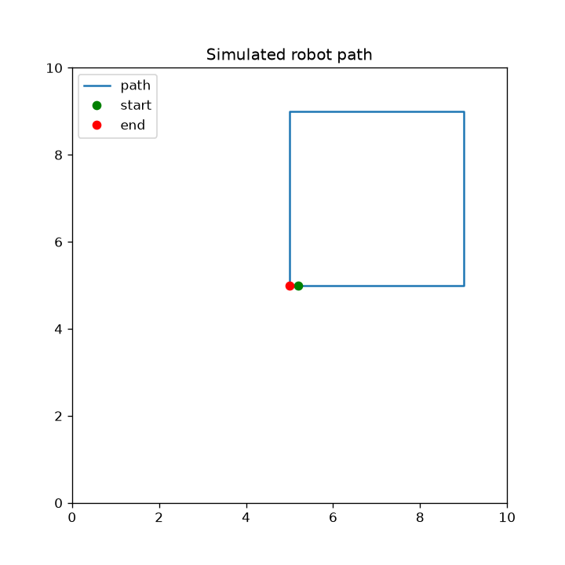

# secure-robot-control

A small security lab: a simulated robot controlled over a network API, first
built **insecure on purpose**, then attacked, then hardened. Every attack is a
script, every defense has an automated test, and the results are saved as
evidence.

## What it demonstrates

| Attack | Insecure v1 (port 8000) | Secure v2 (port 8001) | Defense |
|---|---|---|---|
| Takeover (no credentials) | accepted (HTTP 200) | rejected (HTTP 401) | HMAC-signed requests |
| Replay of a captured command | accepted | rejected (401, "replay detected") | timestamp and one-time nonce |
| Tampering with a signed command | not applicable (nothing is signed) | rejected (401, "bad signature") | signature covers the action |
| Command flooding (300 requests) | 300 of 300 accepted | 287 of 300 blocked (HTTP 429) | rate limit per IP |
| Visibility | no logs | every rejection written to `security.log` | security logging |

Raw output: `attack_results_before.txt` and `attack_results_after.txt`.
Full write-up: [SECURITY_REPORT.md](SECURITY_REPORT.md).

## How it works

- `robot.py`: pure-Python robot simulator (position, heading, speed, arena walls).
- `api.py`: **insecure** v1. Anyone can send commands. Run it on localhost only.
- `api_secure.py`: secure v2. Each command carries `X-Timestamp`, `X-Nonce` and
  `X-Signature = HMAC-SHA256(secret, timestamp.nonce.action)`.
- `signing.py`, `client_secure.py`: signing code and the legitimate operator client.
- `attacks/`: the attack scripts.
- `tests/`: automated tests (run in CI on every push).

The server checks, in this order: rate limit, headers present, timestamp fresh
(30 s), signature valid (constant-time comparison), nonce unused. Nonces are
stored only after the signature is valid, so an attacker cannot fill the store.

## Run it

Requires Python 3.12.

    python3.12 -m venv .venv
    source .venv/bin/activate
    pip install -r requirements.txt

    # create the shared secret (never commit this file)
    python -c "import secrets; print(secrets.token_hex(32))" > .robot_secret

    # terminal 1: insecure server
    uvicorn api:app --host 127.0.0.1 --port 8000
    # terminal 2: secure server
    uvicorn api_secure:app --host 127.0.0.1 --port 8001

    # terminal 3: attacks against the secure server
    export ROBOT_URL=http://127.0.0.1:8001
    cd attacks
    python attack1_takeover.py
    python attack2_replay_signed.py
    python attack4_tamper.py
    python attack3_flood.py      # run last: it triggers the rate limiter

Run the tests with `python -m pytest -v`.

## Known limitations

See the security report. In short: no TLS (signatures give integrity, not
confidentiality), a shared secret instead of per-user keys, in-memory rate
limiting and nonce storage (single server only), and `/state` is open
read-only telemetry.

## Tech

Python 3.12, FastAPI, uvicorn, pytest, GitHub Actions, matplotlib.
